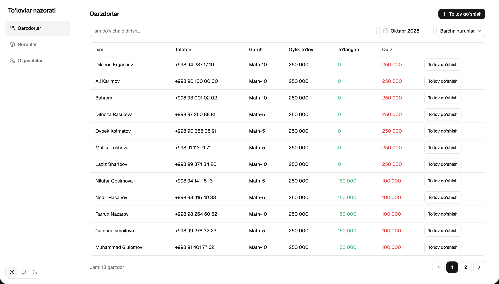
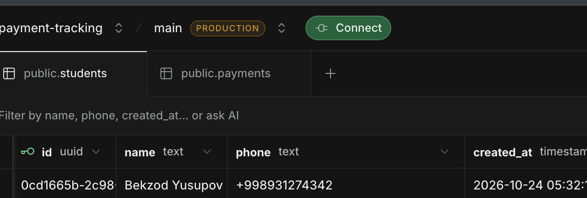
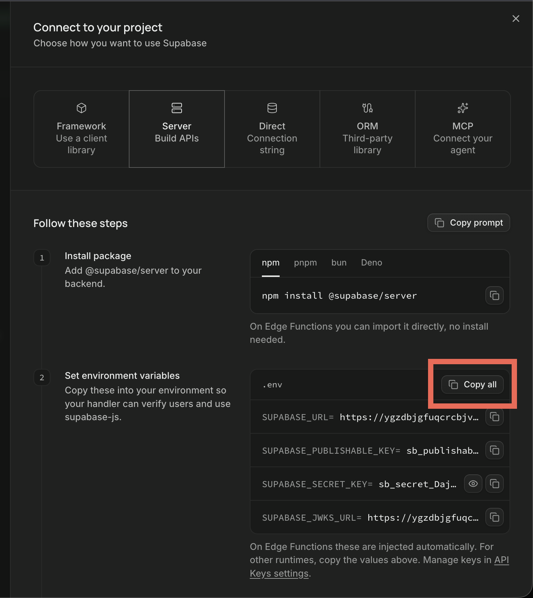

# Toʻlovlarni kuzatish — oʻquv markazi uchun mini tizim

Oʻquvchilar, oylik toʻlovlar, toʻlangan pullar va qarzdorlarni kuzatish uchun web platforma



- **client**: React + TypeScript + Vite, Tailwind CSS, shadcn/ui — `client/`
- **server**: Express + TypeScript, `@supabase/supabase-js` orqali Supabase (Postgres) bilan ishlaydi — `server/`
- **db**: Supabase (free tier). frontend Supabase bilan bevosita bogʻlanmaydi; `secret key` kalitidan faqat server foydalanadi.

## Noldan ishga tushirish

### Talablar

- Node.js
- npm (yoki pnpm/bun) — quyidagi misollarda npm ishlatilgan
- [Supabase](https://supabase.com) hisob qaydnomasi

### 1. Repozitoriyani klonlash va paketlarni oʻrnatish

```bash
git clone https://github.com/developerbola/payment-tracking
cd payment-tracking
npm install --prefix server
npm install --prefix client
```

### 2. Tekin Supabase project (database)

1. https://supabase.com/dashboard sahifasiga oʻting va yangi loyiha yarating (nomi va paroli ixtiyoriy).

### 3. Maʼlumotlar bazasi sxemasini qoʻllash

1. Chap tarafdagi sidebardan **SQL Editor** → **New query** ni oching.
3. "Success no rows ..." yozuvi chiqishi kerak. **Table Editor** boʻlimida `groups`, `students` va `payments` table'lar paydo bo'ladi

### 4. API keylarni olish

Tepadagi "connect" ni bosing



<br />
<br />
Sheet ochiladi, unda "Server Build APIs" ni bosing va "Set environment variables" o'ng tarafidagi "Copy All" ni bosing
<br />
<br />


`server/.env` ga paste qiling va SUPABASE_PUBLISHABLE_KEY bilan SUPABASE_JWKS_URL ni o'chirib yuboring, kerakmas

### 5. `.env.example` fayllaridan nusxa olish

```bash
cp server/.env.example server/.env
cp client/.env.example client/.env.local
```

Soʻng fayllarni quyidagicha toʻldiring:

- `server/.env`:

| Oʻzgaruvchi | Majburiymi | Tavsif |
|---|---|---|
| `SUPABASE_URL` | Ha | Supabase **Project Settings → API** boʻlimidagi loyiha URL manzili |
| `SUPABASE_SECRET_KEY`| Ha | Supabase **secret key**. Server yangi `SUPABASE_SECRET_KEY` nomini ham muqobil sifatida qabul qiladi |

- `client/.env.local`:

| Oʻzgaruvchi | Majburiymi | Tavsif |
|---|---|---|
| `VITE_API_URL` | Ha (haqiqiy serverga ulanish uchun) | Server API manzili, masalan, `http://localhost:8080` |

### 6. Sinov maʼlumotlarini qoʻshish (ixtiyoriy)

Server `.env` fayli sozlangandan soʻng, repozitoriya ildizidan quyidagi buyruqni bajaring:

```bash
cd server
npx tsx --env-file-if-exists=.env scripts/seed-mock.ts
```

script 2 ta guruh, 40 ta oʻquvchi va qarzdorlarni mock data sifatida qoʻshadi. Natijada shu 40 oʻquvchidan 14 nafari qarzdor boʻladi. Mavjud shu nomli guruhlar qayta ishlatiladi. scriptni bir marta ishlating

### 7. frontend va backendni ishga tushirish

```bash
# 1-terminal — server http://localhost:8080 manzilida
npm run dev --prefix server

# 2-terminal — klient http://localhost:5173 manzilida
npm run dev --prefix client
```

Soʻng **http://localhost:5173** manzilini oching.

Serverning production buildini yaratish:

```bash
npm run build --prefix server   # TypeScript'ni tekshiradi va server/dist ichiga kompilyatsiya qiladi
npm run start --prefix server   # .env faylini yuklab, tsx orqali ishga tushiradi
```

Server Vercel’da ham ishlaydi: [`server/src/app.ts`](server/src/app.ts) Express ilovasini eksport qiladi, [`server/src/index.ts`](server/src/index.ts) esa faqat `PORT`/`VERCEL` qiymatlari lokal ishga tushirishni bildirganda `app.listen` chaqiradi.

## API maʼlumotnomasi (`curl` bilan)

Barcha javoblar JSON formatida. Xatolar `{ "error": "message" }` koʻrinishida, 400 (tekshiruv xatosi), 404 (topilmadi), 409 (ziddiyat, masalan, takroriy nom yoki ishlatilayotgan guruh) yoki 500 (kutilmagan xato) holat kodi bilan qaytariladi.

```bash
# Guruhlar roʻyxati
curl http://localhost:8080/groups

# Guruh yaratish (oylik toʻlov guruhga tegishli)
curl -X POST http://localhost:8080/groups \
  -H 'Content-Type: application/json' \
  -d '{"name":"Math-10","price":250000}'

# Guruhni qisman yangilash
curl -X PATCH http://localhost:8080/groups/<group-uuid> \
  -H 'Content-Type: application/json' \
  -d '{"price":808000}'

# Guruhni oʻchirish (ichida oʻquvchi boʻlsa 409; muvaffaqiyatli boʻlsa 204)
curl -X DELETE http://localhost:8080/groups/<group-uuid>

# Sahifalangan oʻquvchilar roʻyxati (har bir qatorda guruh IDsi, nomi va
# oylik toʻlov monthlyAmount sifatida beriladi). Parametrlar: page (standart 1),
# limit (standart 12, eng koʻpi 1000), search (ism boʻyicha katta-kichik harfga
# sezgir boʻlmagan qidiruv).
# Javob: { items: [...], total, page, limit, totalPages }
curl http://localhost:8080/students
curl 'http://localhost:8080/students?page=2&limit=12&search=ali'

# Oʻquvchini guruhga qoʻshish
curl -X POST http://localhost:8080/students \
  -H 'Content-Type: application/json' \
  -d '{"name":"Ali","phone":"+998901234567","groupId":"<group-uuid>"}'

# Oʻquvchini boshqa guruhga oʻtkazish (qisman yangilash)
curl -X PATCH http://localhost:8080/students/<student-uuid> \
  -H 'Content-Type: application/json' \
  -d '{"groupId":"<group-uuid>"}'

# Oʻquvchini oʻchirish (toʻlovlari ham oʻchadi; muvaffaqiyatli boʻlsa 204)
curl -X DELETE http://localhost:8080/students/<student-uuid>

# Oʻquvchiga toʻlov qoʻshish (oy YYYY-MM formatida)
curl -X POST http://localhost:8080/students/1/payments \
  -H 'Content-Type: application/json' \
  -d '{"amount":250000,"month":"2026-10"}'

# Oʻquvchining toʻlovlari roʻyxati (oylar boʻyicha yangisidan eskisiga)
curl http://localhost:8080/students/1/payments

# Joriy oy qarzdorlari
curl http://localhost:8080/debtors

# Muayyan oy qarzdorlari (YYYY-MM)
curl 'http://localhost:8080/debtors?month=2026-10'
```

## Loyihalash boʻyicha izohlar

- **Narx guruhda saqlanadi**: guruhda `name` va `price` mavjud; oʻquvchi `group_id` orqali guruhga bogʻlanadi. Guruh narxi oʻzgarsa, shu guruhdagi barcha oʻquvchilarning oylik toʻlovi ham oʻzgaradi.
- **Bogʻliq yozuvlarni birga oʻchirish**: oʻquvchi oʻchirilganda uning barcha toʻlovlari ham oʻchadi (sxemadagi `ON DELETE CASCADE`). Oʻquvchisi bor guruhni oʻchirib boʻlmaydi (409). Interfeys oʻchirishdan oldin tasdiqlashni soʻraydi.
- **Pul butun sonlarda**: summalar soʻmda butun son sifatida saqlanadi; kasr son ishlatilmagani uchun yaxlitlash xatolari boʻlmaydi.
- **Oy hisob-kitobi**: har bir toʻlov bevosita `YYYY-MM` oyiga yoziladi. Tanlangan oy qarzi `guruh narxi - shu oyga toʻlangan summa` sifatida hisoblanadi; boshqa oylardagi toʻlovlar hisobga olinmaydi.
- **Ortiqcha toʻlov keyingi oyga oʻtmaydi**: bir oyda oylik toʻlovdan ortiq toʻlangan summa keyingi oy qarzini kamaytirmaydi; qisman toʻlangan oy ham keyingi oydagi ortiqcha toʻlov bilan yopilmaydi. Qoldiq hisobini yaxshilash haqida quyidagi “Yana bir hafta boʻlsa, nimalarni yaxshilardim” boʻlimiga qarang.
- **Xavfsizlik**: barcha jadvallarda Row Level Security yoqilgan, lekin hech qanday siyosat (policy) belgilanmagan. Server RLSʼni chetlab oʻtadigan service role kalitidan foydalanadi; demak, ommaviy anon kalitda kirish huquqi yoʻq. Maʼlumotlar bazasiga faqat server ulanadi.

## Yana bir hafta boʻlsa, nimalarni yaxshilardim

1. **Autentifikatsiya** — hech boʻlmaganda administrator uchun umumiy parol yoki Supabase Auth qoʻshish kerak, chunki hozir URL manzilini bilgan har kim maʼlumotlarni koʻrishi va tahrirlashi mumkin.
2. **To'lov tarixi** — 
3. **Kurslar ro'yxati** — kurslar page'i: qo'shish, o'chirish, tahrirlash va hkz
4. **"RBAC"** - ya'ni "Role-based access control" agar kerak bo'lsa
5. **Mentorlar** - mentorlar page'i: qo'shish, o'chirish, tahrirlash; keyin groups page'da xar bir guruh uchun o'qituvchi belgilash

## Loyiha tuzilishi

```
assets/                 # README.md uchun kerakli rasmlar

client/                 # React + Vite + Tailwind + shadcn/ui
├── pages/              # Qarzdorlar, toʻlov formasi, oʻquvchilar CRUD amallari
├── lib/api.ts          # type safe API klienti (VITE_API_URL)
└── .env.example → .env.local

server/                 # Express API (TypeScript + tsx)
├── src/routes/         # oʻquvchilar/toʻlovlar va qarzdorlar route'lari
└── .env.example

supabase/
├── schema.sql          # jadvallar, indekslar, RLS va get_debtors funksiyasi
```
